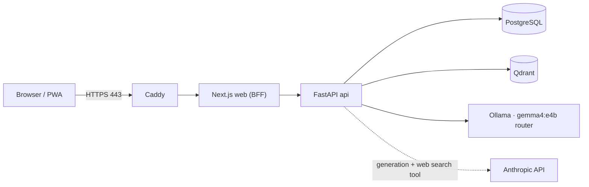
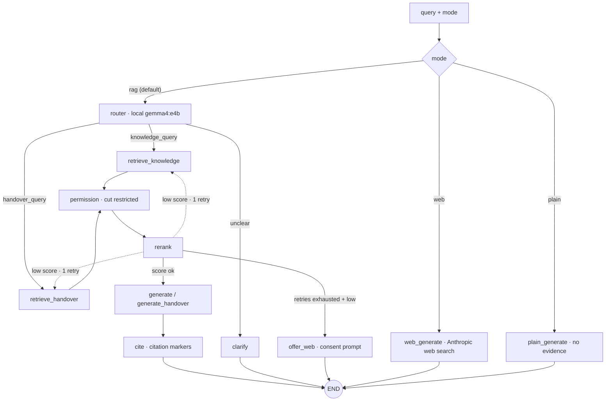
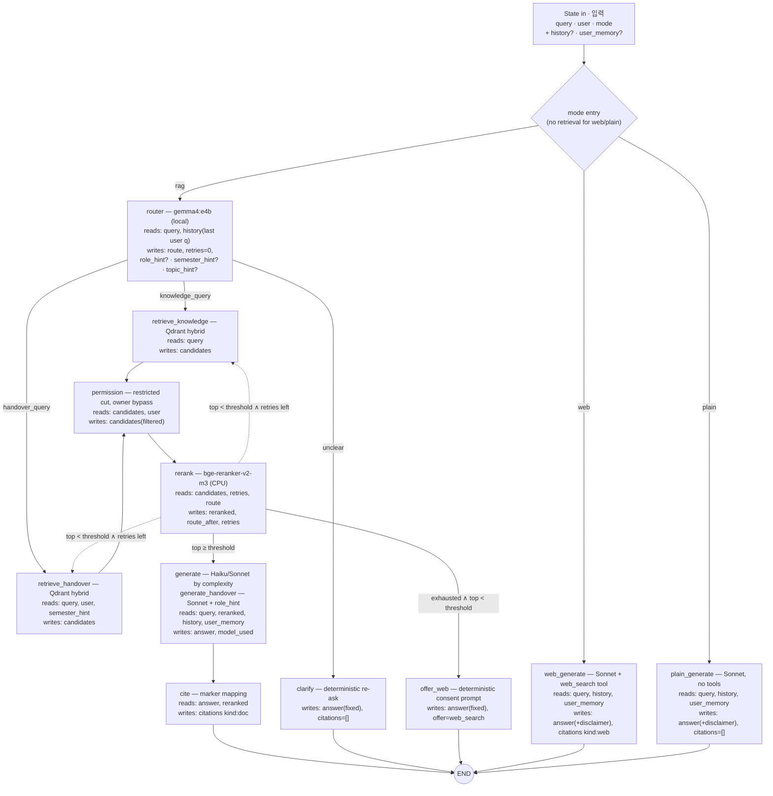
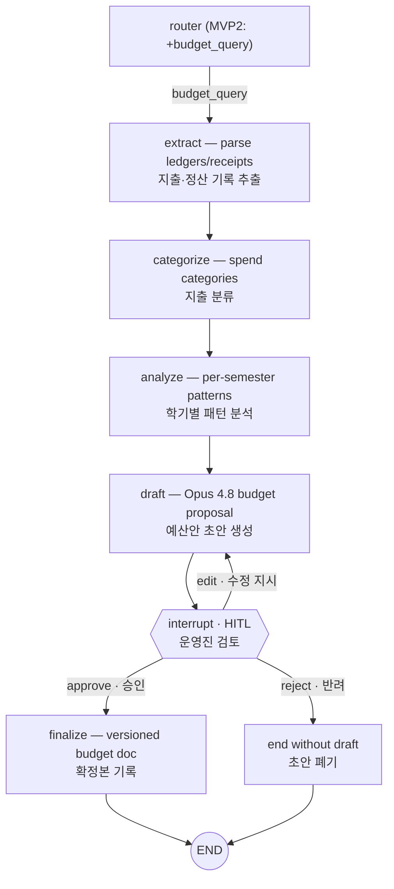

# Dajung Ark

**EN** — A self-hosted knowledge & handover assistant for a university coffee/tea club ("Dajung", SKKU). Retrieval-augmented answers over the club's own documents, with a budget-drafting HITL agent planned next. Runs entirely on a home server; club data never leaves it.

**KO** — 성균관대 커피·차 동아리 '다정'의 자가호스팅 지식·인수인계 어시스턴트. 동아리 자료 기반 RAG 답변을 제공하며, 다음 단계로 예산안 작성 HITL 에이전트를 붙인다. 홈서버에서만 구동 — 동아리 자료는 서버 밖으로 나가지 않는다.

## Status · 현재 상태

**EN** — MVP1 web serving complete: SSE chat with cited RAG answers, session history context, a consent-gated web-search fallback, a three-tier admin surface (accounts, president transfer, invitations, semester rosters, document management), and PWA packaging. Next: MVP2 budget-drafting agent with human-in-the-loop approval.

**KO** — MVP1 웹 서빙 완료: 인용 포함 RAG 답변의 SSE 채팅, 세션 히스토리 맥락, 사용자 동의 기반 웹 검색 폴백, 3계층 관리자 기능(계정·회장 이양·통과번호·학기 명단·문서 관리), PWA 패키징. 다음: 운영진 승인 루프(HITL)를 갖춘 MVP2 예산안 에이전트.

## Architecture · 아키텍처

### Service topology · 서비스 토폴로지

**EN** — Only Caddy publishes ports; every other service stays on the internal network, and club data never leaves the server (the single external call is the Anthropic API).

**KO** — 포트는 Caddy만 공개한다. 나머지 서비스는 내부 네트워크 전용이며, 동아리 자료는 서버 밖으로 나가지 않는다(유일한 외부 호출은 Anthropic API).



### Chat turn — overview · 채팅 턴 개요

**EN** — Each chat turn runs the LangGraph below. Permission filtering cuts restricted chunks before any LLM sees them; when retrieval stays below the confidence threshold after a retry, the turn ends with an explicit web-search offer instead of an ungrounded answer (`web`/`plain` are separate, user-chosen follow-up modes with their own disclaimers).

**KO** — 채팅 턴마다 아래 LangGraph가 실행된다. 권한 필터가 restricted 청크를 LLM에 닿기 전에 잘라내며, 재시도 후에도 신뢰도 임계값에 못 미치면 근거 없는 답변 대신 명시적 웹 검색 제안으로 턴을 마친다(`web`/`plain`은 사용자가 직접 선택하는 별도 후속 모드로, 각자 고정 디스클레이머를 단다).



### LangGraph — nodes & state channels · 노드·상태 상세

**EN** — The same graph with every node annotated: what it reads from and writes to the shared `State` (a `TypedDict`; keys are set only when present). The router is the only local-LLM call; `clarify` and `offer_web` are deterministic (no LLM at all).

**KO** — 같은 그래프를 노드별로 주석화한 버전: 공유 `State`(`TypedDict`, 키는 있을 때만 설정)에서 무엇을 읽고 무엇을 쓰는지. 라우터만 로컬 LLM 호출이고, `clarify`·`offer_web`은 결정적 노드(LLM 없음)다.



### Chat turn — SSE event sequence · SSE 이벤트 순서

**EN** — What the browser actually receives per turn. `route` and per-stage `status` events exist only on `rag` turns; `offer` appears on `done` only when the turn ended with the web-search consent prompt.

**KO** — 턴마다 브라우저가 실제로 받는 이벤트. `route`·단계별 `status`는 `rag` 턴에만 있고, `offer`는 웹 검색 동의 제안으로 끝난 턴의 `done`에만 붙는다.

```mermaid
sequenceDiagram
    participant B as Browser / PWA
    participant W as Next.js BFF
    participant A as FastAPI
    participant G as LangGraph
    B->>W: POST /api/chat/stream { query, mode?, session_id? }
    W->>A: proxy + auth (JWT re-checked against DB)
    A->>A: daily limit · Qdrant readiness (rag only)
    A->>G: astream(State)
    A-->>B: session (new session only)
    A-->>B: status ×n (routing → retrieving → generating; rag only)
    A-->>B: route (rag only)
    A-->>B: token ×n (PII-masked chunks)
    A-->>B: citations (kind doc | web, when any)
    A-->>B: done { remaining, offer? }
```

### MVP2 — budget agent with HITL · 예산 에이전트 (계획)

**EN** — *Planned, not yet implemented.* MVP2 adds a `budget_query` route and a budget subgraph that drafts semester budgets from past ledgers. The draft **always pauses on a LangGraph `interrupt`** for a human approve/edit/reject loop — budget output is never fully automated, and this is the only place interrupts are used (chat fallback stays two-turn by design).

**KO** — *계획 단계 — 미구현.* MVP2는 `budget_query` 라우트와 예산 서브그래프를 추가한다. 과거 장부 기반으로 학기 예산안을 작성하되, 초안은 **반드시 LangGraph `interrupt`로 멈춰** 운영진 승인/수정/반려 루프를 거친다 — 예산 산출은 완전 자동화하지 않으며, interrupt는 이곳에서만 쓴다(채팅 폴백은 설계상 2턴 유지).



## Stack · 스택

- Python 3.12 · uv · typer CLI · LangGraph
- Qdrant (hybrid dense+sparse) · BGE-M3 / bge-reranker-v2-m3 (CPU)
- Ollama `gemma4:e4b` (local router) · Anthropic API (generation)
- FastAPI + Next.js 15 (serving phase · 서빙 단계)

## Layout · 구조

```
api/app/    core/ ingest/ rag/ llm/ graph/   # Python package
api/tests/                                    # pytest only — no tests in source dirs
prompts/    scripts/    docker/ compose/
data/       # local only, gitignored — real club documents
```

## Local development · 로컬 개발

```sh
uv sync
uv run dajung ingest data/      # index local documents · 로컬 문서 인덱싱
uv run dajung ask "질문"         # cited answer in terminal · 인용 포함 답변
uv run pytest                   # quality gate (external services excluded)
```

## Compose Serving · Compose 서빙

```sh
cp .env.example .env              # fill secrets and PUBLIC_HOST before production
docker compose config             # validate caddy-only public ports and env wiring
docker compose up -d --build       # run on the server after docs/SECURITY.md §5.7 gates
make dry DIR=data/knowledge        # parse without Qdrant upserts · Qdrant 업서트 없이 파싱
make ingest DIR=data/knowledge     # index from inside the API container · API 컨테이너에서 인덱싱
make stats                         # inspect the server index · 서버 인덱스 통계
make ask Q="개완 우리는 법"        # ask through the server stack · 서버 스택으로 질문
```

**EN** — Compose bind-mounts the host `./data` directory read-write at `/app/data` in the
API container. Admin uploads, recoverable `.trash` moves, and `.ingest_manifest.json` therefore
remain on the host across API restarts. The `make` RAG commands require the Compose stack; use
the host `uv run dajung ...` commands above for local development.

**KO** — Compose는 호스트 `./data`를 API 컨테이너의 `/app/data`에 읽기·쓰기 방식으로
마운트한다. 따라서 관리자 업로드, 복구 가능한 `.trash` 이동, `.ingest_manifest.json`은
API 재시작 후에도 호스트에 남는다. `make` RAG 명령은 Compose 스택이 필요하며 로컬 개발은
위의 호스트 `uv run dajung ...` 명령을 사용한다.

### First administrator · 최초 관리자

**EN** — On a fresh database, issue one invitation and complete web signup for the initial
account. Then claim the one-time owner slot from the server shell. After that, invite the
current president 서지선 and appoint that signed-up account as president. Replace the example
emails below; never record the plaintext invitation codes in files or logs.

**KO** — fresh DB에서는 통과번호 하나를 발급해 최초 계정의 웹 가입을 마친 뒤 서버 셸에서
1회용 owner 자리를 승격한다. 이후 현 회장 서지선을 초대해 가입을 마치고 president로 임명한다.
아래 이메일은 실제 가입 이메일로 바꾸며, 통과번호 평문은 파일이나 로그에 기록하지 않는다.

```sh
docker compose exec api dajung invite create --note "운하"
# Complete web signup as owner@example.com. · owner@example.com으로 웹 가입 완료
docker compose exec api dajung owner claim owner@example.com
docker compose exec api dajung invite create --note "서지선"
# Complete web signup as president@example.com. · president@example.com으로 웹 가입 완료
docker compose exec api dajung president set president@example.com
```

## Notes · 참고

**EN** — Internal design docs and all club data are intentionally not in this repository. Permission filtering is enforced at retrieval time and re-checked in process; the regression suite (`api/tests/test_permission.py`) gates every merge.

**KO** — 내부 설계 문서와 동아리 자료는 의도적으로 리포에 없다. 권한 필터링은 검색 단계에서 강제되고 프로세스 내에서 재검사되며, 회귀 테스트(`api/tests/test_permission.py`)가 모든 머지를 게이트한다.
